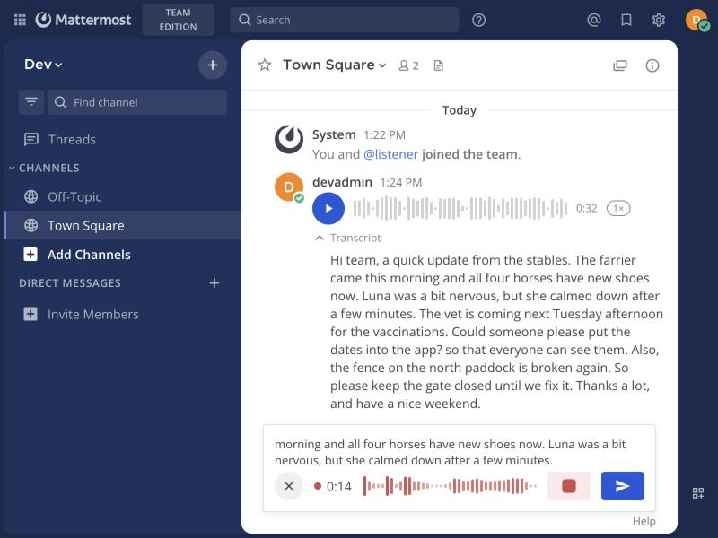

# Voice messages for Mattermost

Telegram-style voice messages for [Mattermost](https://mattermost.com). Hold the mic to record, let go to send, and see the transcript appear while you talk. Transcripts are optional and run on Amazon Bedrock.



**Status:** v0.2.0. In use on a self-hosted Mattermost 11.7 Team Edition with the desktop app and the Android app, and tested in Chromium-based browsers. Bug reports and pull requests are welcome.

## Features

- **Record in the desktop app and the browser.** Press and hold the mic in the message box, then let go to send. Slide left to cancel. Drag up to lock, so you can talk hands-free. When locked, ✕ cancels, stop lets you listen first, and send sends.
- **Keyboard.** Hold **⌥⇧V** (Alt+Shift+V) to record and let go to send; Esc cancels. A short tap starts a hands-free recording; tap again or press Enter to send. When locked: Esc cancels, ⌘S / Ctrl+S stops and plays it back, Enter sends.
- **Live transcript.** While you talk, the browser sends short chunks, cut at pauses, to the server, and the text appears a second or two behind you. Each chunk is written in the language spoken, never translated. When you send, the transcript is already in the message, so mobile users can read it too, and the post never shows "Edited".
- **Player.** A waveform you can click to seek, 1× / 1.5× / 2× speed, one message playing at a time, and the transcript under a chevron.
- **Small files that play everywhere.** The browser's own encoder records AAC (`.m4a`), so the plugin ships no encoder. Before upload, the plugin rewrites the file so every player knows its length. The audio itself is not changed.
- **Mobile.** The Mattermost mobile apps play voice messages and show the transcript as the message text. They cannot record, because Mattermost mobile does not run plugin UI.
- **English and German.** The plugin's buttons and hints follow each user's Mattermost language. Other languages can be added; see [CONTRIBUTING.md](CONTRIBUTING.md#translations).

## Requirements

- A self-hosted Mattermost server, version 11.7 or later, on Linux (amd64 or arm64). Older versions have not been tested.
- HTTPS. Browsers and the desktop app allow the microphone only on HTTPS sites (and on `localhost`).
- Plugin uploads enabled. In `config.json`, set `PluginSettings.EnableUploads` to `true`, or set the environment variable `MM_PLUGINSETTINGS_ENABLEUPLOADS=true`, and restart the server.
- For transcripts only: an AWS account that can call Amazon Bedrock in `eu-west-1`. Without one, voice messages work without transcripts.

## Install

1. Download `de.horseup.mm-av-<version>.tar.gz` from the [latest release](https://github.com/horseup/mattermost-plugin-voice-messages/releases/latest). The `.sha256` file next to it has the checksum.
2. In Mattermost, go to **System Console → Plugins → Plugin Management**, upload the file, and click **Enable** next to "Voice messages".
   Or install it with [mmctl](https://docs.mattermost.com/manage/mmctl-command-line-tool.html), which needs the same upload setting:

   ```bash
   mmctl plugin install-url https://github.com/horseup/mattermost-plugin-voice-messages/releases/download/v0.2.0/de.horseup.mm-av-0.2.0.tar.gz
   mmctl plugin enable de.horseup.mm-av
   ```

3. Reload Mattermost. A mic appears in the formatting bar of every message box.

To update, upload the new version the same way. Your settings stay. Messages sent with an older version keep their files and transcripts.

## Set up transcripts (optional)

The plugin sends audio chunks to [Voxtral](https://mistral.ai/news/voxtral) on Amazon Bedrock. It has been tested in `eu-west-1` (Ireland), where the model is available.

1. In AWS, create an IAM user (or role) for the plugin, and give it only this permission:

   ```json
   {
     "Version": "2012-10-17",
     "Statement": [{
       "Effect": "Allow",
       "Action": "bedrock:InvokeModel",
       "Resource": "arn:aws:bedrock:eu-west-1::foundation-model/mistral.voxtral-small-24b-2507"
     }]
   }
   ```

2. Make sure the account can use the model in that region; see [Bedrock model access](https://docs.aws.amazon.com/bedrock/latest/userguide/model-access.html).
3. Create an access key for the user. Then, in **System Console → Plugins → Voice messages**, enter the key, or leave the key fields empty and give the Mattermost server the usual `AWS_ACCESS_KEY_ID`, `AWS_SECRET_ACCESS_KEY` and (optionally) `AWS_SESSION_TOKEN` environment variables.
4. Recommended: set Bedrock data retention to `none` for the account or project; see the [AWS docs](https://docs.aws.amazon.com/bedrock/latest/userguide/data-retention.html).

| Setting | Default | What it does |
| --- | --- | --- |
| Transcribe voice messages | on | Turns transcripts on or off. Without AWS credentials, transcripts are off anyway. |
| AWS region | `eu-west-1` | Bedrock region that serves the model. |
| Model ID | `mistral.voxtral-small-24b-2507` | Voxtral Small. Voxtral Mini (`mistral.voxtral-mini-3b-2507`) is cheaper, but in testing it often wrote in the wrong language and made up text for background noise. If you switch, allow that model in the policy too. |
| AWS access key ID / secret | empty | See step 3. |
| Fallback language | `English` | The model first names the spoken language, then transcribes in it. This language is used only when it can't name one. Write the English name, for example `German`. |
| Maximum length (seconds) | `300` | Recording stops at this length, and you can listen before sending. |

**Languages.** Tested with English and German, including both in one message. Voxtral is made for English, Spanish, French, Portuguese, Hindi, German, Dutch and Italian; other languages may work less well.

**What leaves your server.** Only the speech-to-text requests: 16 kHz WAV chunks of 3–15 s, each sent twice to Bedrock in the region you set (once to name the language, once to transcribe). The voice file itself stays in Mattermost's file storage. Chunks the browser recognizes as silence are never sent. The plugin does not log audio or transcripts.

**Cost.** Voxtral Small in `eu-west-1` costs $0.12 per 1M input tokens and $0.35 per 1M output tokens. One chunk of up to 30 s is about 400 input tokens per request, and each chunk takes two requests. 400 minutes of voice messages a month cost roughly $0.30–0.50.

**Model end of life.** AWS lists both Voxtral models as Legacy on Bedrock, with end of life on 30 March 2027. A replacement will come in a later version.

## Known limits

- The mobile apps play voice messages but cannot record them.
- The mic is part of the formatting bar, so it is hidden when the formatting bar is hidden.
- Browsers that can't record AAC fall back to Opus in WebM, which the iOS app may not play.
- A word can be cut where two chunks meet.
- A single short word can come out in the wrong language (for example "Ja." as "Yeah.").
- A sentence that names a language ("the transcript was in German") can be taken for that language, and that chunk then drops out of the transcript.

## Troubleshooting

- **No mic in the message box:** check that the plugin is enabled, reload the page, and show the formatting bar (the "Aa" button).
- **"Transcript not available":** check the key, the IAM policy and the region in the plugin settings. **System Console → Server Logs** shows the Bedrock error; search for `de.horseup.mm-av`.
- **The browser doesn't ask for the microphone:** the site must use HTTPS, and the browser or OS must allow microphone access for it.

## Development

See [CONTRIBUTING.md](CONTRIBUTING.md). In short: `docker compose -f dev/docker-compose.yml up -d`, `./dev/seed.sh`, `make deploy-local`. Everything builds in Docker, so you need no Go or Node.js on your machine.

Background: [docs/SCOPE.md](docs/SCOPE.md) has the original scope and [docs/SPIKE.md](docs/SPIKE.md) the speech-to-text evaluation. Changes are listed in [CHANGELOG.md](CHANGELOG.md).

## License

[MIT](LICENSE). The server binary includes third-party Go modules under their own licenses. See [NOTICE](NOTICE) and [THIRD_PARTY_NOTICES.md](THIRD_PARTY_NOTICES.md); every release bundle also ships their license and NOTICE files in `third_party/`.

Security reports: see [SECURITY.md](SECURITY.md).

Built by [HorseUp](https://horseup.de). Mattermost is a trademark of Mattermost, Inc. This project is not affiliated with or endorsed by Mattermost, Amazon or Mistral AI.
